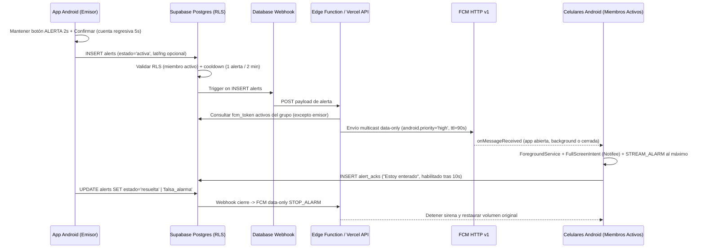

# Arquitectura Técnica Unificada — Asociación Bello Horizonte

> Combina el **Portal Web Institucional y Administrativo** de la Asociación Bello Horizonte con el plan de viabilidad v3.1 de la **Alarma Vecinal Android ("Robo en la cuadra")** y la hoja de ruta post-MVP (**WhatsApp Cloud API**, **Reuniones** y **Actas con conformidades**).

---

## 1. Decisiones Técnicas Confirmadas

| Dimensión | Decisión |
| :--- | :--- |
| **App Móvil (MVP)** | **Android — React Native + TypeScript** (Notifee + módulo nativo corto / `react-native-volume-manager` para `STREAM_ALARM`). iOS queda para después. |
| **Portal Web** | **Next.js / React + TypeScript** desplegado en **Vercel** (información de la asociación, comunicados, política de privacidad pública para Google Play / Ley 29733 y consola admin). |
| **Backend & Base de Datos** | **100% Supabase** (PostgreSQL + Auth + Realtime + Storage + `pg_cron` + **Row Level Security (RLS)** + **Database Webhooks** + **Edge Functions** en Deno/TypeScript). **Vercel** se usa únicamente para alojar el Portal Web Next.js. |
| **Transporte Push Crítico** | **Firebase Cloud Messaging (FCM HTTP v1)** — mensajes `data-only` de prioridad alta (`priority: "high"`), invocados desde Edge Function / Vercel API con cuenta de servicio. |
| **Escala inicial** | ~50 usuarios en 1 cuadra/asociación (modelo multi-grupo ya soportado). Cabe en planes gratuitos (Supabase Free + Vercel Free + FCM gratis). |
| **Contexto local** | **Perú (+51)**, emergencia **Serenazgo / PNP 105**, cumplimiento **Ley 29733** (Protección de Datos Personales). |
| **Publicación** | Cuenta Google Play ya disponible (US$25 pagado); requiere prueba cerrada de 12 testers por 14 días. |

---

## 2. Arquitectura General

```mermaid
flowchart LR
    Web["Portal Web (Vercel / Next.js)\nInfo Asociación + Admin + Privacidad"] -->|HTTPS + Supabase SDK| Supa[("Supabase\nPostgres + Auth + RLS + Storage")]
    AppSender["App Android (React Native + TS)\nBotón ALERTA + Info + Reuniones"] -->|INSERT alerts (estado=activa)| Supa
    Supa -->|Database Webhook| Func["Supabase Edge Function\n(o Vercel Serverless API)"]
    Func -->|FCM HTTP v1 (data-only, high)| AppAll["Celulares Android con la App\n(Notifee + ForegroundService + STREAM_ALARM)"]
    Func -.->|Fase 3: WhatsApp Cloud API| WA["Vecinos sin la App\n(Plantilla Utility Meta)"]
    AppAll -->|INSERT alert_acks (Estoy enterado)| Supa
    AppAll -->|Realtime / Push cierre| Supa
```

---

## 3. Flujo Crítico del Botón de Pánico ("Robo en la cuadra")



### Reglas de Negocio Cerradas para el MVP
- **Texto de la alerta**: `"¡ALERTA! Robo en la cuadra – [Nombre] avisó a las [hora]"` (sin anonimato para desincentivar abusos).
- **Sonido**: Sirena fuerte en bucle (archivo propio libre de derechos embebido en la app) reproducida por `STREAM_ALARM` con volumen elevado al máximo y restaurado al detener.
- **Detención**: Suena hasta pulsar **"Estoy enterado"** (botón habilitado tras **10 segundos**, con opción de **silenciar 1 minuto**) o hasta que el emisor/admin cierre la alerta (`resuelta` / `falsa_alarma`).
- **Emergencia local**: Botón directo **"Llamar 105"** en la pantalla roja de alarma.
- **WhatsApp en MVP**: Solo botón gratuito **"Compartir alerta por WhatsApp"** (`wa.me`). WhatsApp Cloud API (Meta Business) pasa a Fase 3.
- **Ingreso al grupo en MVP**: Código de invitación (ej. `CUADRA-4821`) + nombre + teléfono (`+51`) + consentimiento Ley 29733 → estado `pendiente` hasta que uno de los **2 administradores** (titular o suplente) apruebe (`activo`). OTP por WhatsApp/SMS queda para fase posterior.

---

## 4. Contratos de Backend (Supabase + Edge Functions / Vercel)

### Acceso Directo Seguro (Supabase Client + RLS)
- **Registro / Perfil**: `profiles`, `groups`, `memberships` (validación por código de invitación, aprobación por rol `admin`).
- **Portal Asociación**: lectura pública/socios de `association_info` y `announcements`; escritura solo para `admin` / `directiva`.
- **Alertas**: `INSERT alerts` (solo `memberships.estado = 'activo'`, verificando cooldown de 2 min por usuario); `INSERT alert_acks`; `UPDATE alerts` (`resuelta` / `falsa_alarma` solo autor o `admin`).

### Edge Functions / Endpoints Serverless
1. **`dispatch-panic-alert`** (disparada por Database Webhook en `INSERT` de `alerts`):
   - Lee tokens FCM activos del `group_id` excluyendo al emisor.
   - Envía FCM HTTP v1 `data-only` con `type: "PANIC_ALARM"`, `alertId`, `groupName`, `senderName`, `timestamp`, `lat`, `lng`.
   - Limpia tokens inválidos (`UNREGISTERED`).
   - *(Fase 3)*: Envía plantilla Utility por WhatsApp Cloud API a miembros sin `fcm_token`.
2. **`stop-panic-alert`** (disparada por Database Webhook en `UPDATE` de `alerts` cuando pasa a `resuelta` o `falsa_alarma`):
   - Envía FCM HTTP v1 `data-only` con `type: "STOP_ALARM"` y `alertId` para detener la sirena en todos los celulares y notificar cierre/falsa alarma.
3. **`meeting-reminders`** *(Fase 5 — `pg_cron`)*:
   - Envía recordatorios por canal Android **normal** (separado del canal de emergencia) al crear reunión, 1 día antes y 1 hora antes.
4. **`transcribe-and-draft-minute`** *(Fase 7)*:
   - Transcribe audio (Whisper / Google STT español peruano), genera borrador de acta con IA (Gemini), elimina el audio tras generar el acta.

---

## 5. Módulos Futuros Ya Previstos (Post-MVP)
- **Fase 3**: WhatsApp Cloud API + OTP WhatsApp/SMS.
- **Fase 5**: Convocatoria y recordatorios de reuniones + confirmación de asistencia.
- **Fase 6**: Editor de actas + exportación a **PDF imprimible para libro de actas legalizado** (con **SHA-256**, cuadro de conformidades digitales, acuse de recibido y firma simple dibujada — sin firma digital SUNARP/Ley 27269).
- **Fase 7**: Grabación de reuniones con *Foreground Service* y notificación visible + consentimiento Ley 29733 + transcripción + borrador con IA.

---

## 6. Nota Operativa sobre Supabase Free
- El plan gratuito de Supabase pausa proyectos tras 7 días sin actividad. Considerar un job de keep-alive controlado o evaluar Supabase Pro (US$25/mes) cuando la asociación entre en uso continuo.
