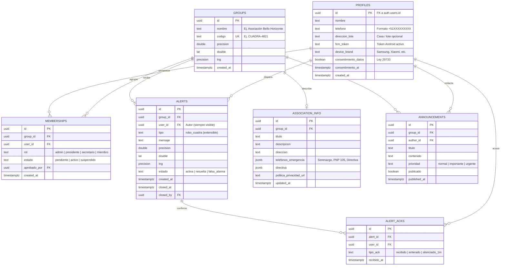

# Diseño de Base de Datos (Supabase PostgreSQL + RLS) — Asociación Bello Horizonte

Modelo unificado que cubre el **MVP** (Alarma Vecinal + Portal de la Asociación Bello Horizonte) y deja listas las tablas de **Reuniones y Actas** (Fases 5–7) sin requerir rediseño.

---

## 1. Diagrama Entidad-Relación (Núcleo MVP + Portal Asociación)

---

## 2. Esquema Adicional Post-MVP (Reuniones, Grabaciones y Actas — Fases 5 a 7)

Las tablas quedan definidas en diseño para añadirlas mediante migraciones limpias sin alterar el núcleo:

- **`meetings`** `(id, group_id, titulo, fecha, lugar, agenda, estado, created_by, created_at)`
- **`meeting_attendance`** `(id, meeting_id, user_id, respuesta ['asistire'|'no_asistire'|'pendiente'], asistio, updated_at)`
- **`recordings`** `(id, meeting_id, storage_path, consentimientos jsonb, estado ['grabando'|'procesando'|'eliminado'], created_at)` *(el archivo de audio se elimina de Supabase Storage tras generar el acta — retención mínima Ley 29733)*
- **`transcripts`** `(id, recording_id, texto, proveedor, created_at)`
- **`minutes`** `(id, meeting_id, contenido, estado ['borrador'|'revision'|'aprobada'|'asentada_en_libro'], pdf_path, hash_sha256, plazo_observaciones_hasta, aprobada_por, created_at)`
- **`minute_signatures`** `(id, minute_id, user_id, tipo ['acuse_recibo'|'conformidad_simple'], firmado_at, firma_img_path, dispositivo_meta)` *(respaldo digital para el libro de actas legalizado; no firma certificada Ley 27269)*

---

## 3. Políticas de Row Level Security (RLS) Obligatorias en Supabase

1. **`groups`**:
   - Lectura permitida a usuarios autenticados solo para su grupo (o verificación de existencia por `codigo` mediante función RPC `join_group_by_code` con `SECURITY DEFINER` para no exponer la lista completa de grupos).
2. **`memberships`**:
   - Un usuario puede leer su propia membresía y los miembros activos de su mismo grupo.
   - Solo usuarios con `rol = 'admin'` y `estado = 'activo'` en ese `group_id` pueden actualizar `estado` (`pendiente` → `activo` / `suspendido`) o regenerar el `codigo` del grupo.
3. **`alerts`**:
   - `INSERT`: Solo permitido si el usuario tiene `memberships(group_id, user_id, estado='activo')` y no ha creado otra alerta en los últimos **2 minutos** (validado por trigger/constraint SQL en Postgres además del cliente).
   - `SELECT`: Miembros activos del mismo `group_id`.
   - `UPDATE` (cierre `resuelta` / `falsa_alarma`): Solo el autor (`user_id = auth.uid()`) o un `admin` activo del grupo.
4. **`alert_acks`**:
   - `INSERT` / `SELECT`: Miembros activos del grupo dueño de la alerta.
5. **`announcements` y `association_info`**:
   - `SELECT`: Público (si `publicado = true` para el portal web) o miembros activos.
   - `INSERT` / `UPDATE` / `DELETE`: Solo `admin`, `presidente` o `secretario`.

---

## 4. Índices Críticos y Retención de Datos (Ley 29733)

- `idx_memberships_group_active` sobre `memberships(group_id, estado)` — Lookup instantáneo de miembros activos al disparar una alerta.
- `idx_alerts_group_created` sobre `alerts(group_id, created_at DESC)` — Historial y validación de cooldown `(user_id, created_at DESC)`.
- `idx_alert_acks_alert` sobre `alert_acks(alert_id, user_id)` (`UNIQUE` por `(alert_id, user_id, tipo_ack)`).
- **Retención**: Política de limpieza programada (`pg_cron`) para alertas antiguas (> 90 días, configurable) y función de **eliminación de cuenta** a solicitud del usuario (Ley 29733 y requisito de Google Play).
