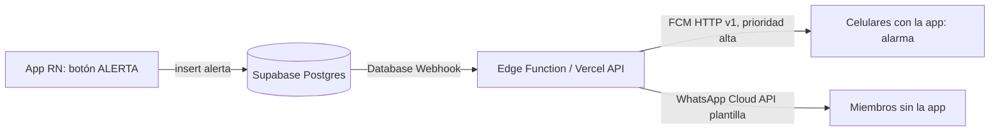

# Plan v2: Alarma vecinal "Robo en la cuadra" (Android, Supabase + Vercel)

## 1. Decisiones confirmadas
| Tema | Decisión |
|---|---|
| Plataforma | Android (React Native + TypeScript); iOS queda para después |
| Backend / BD | Supabase (Postgres, Auth, Realtime, Edge Functions) |
| API MVP | Vercel free (funciones serverless) o directamente Edge Functions de Supabase |
| Usuarios | ~50 (cabe de sobra en planes gratuitos) |
| País | Perú (+51), emergencia: Serenazgo/PNP 105 |
| Quién activa | **Cualquier usuario registrado** con la app |
| Alarma | Sonido fuerte por el **altavoz** del celular, aunque esté en silencio |
| Aviso a quien no tiene la app | Mensaje de WhatsApp |
| Cuenta Google Play | Ya disponible (US$25 pagado) |

## 2. Arquitectura

- **Push:** Supabase no envía push por sí mismo; se usa **Firebase Cloud Messaging (gratis)** solo como transporte. El backend lo llama con la cuenta de servicio.
- **Mensajes data-only** de prioridad alta: la app despierta y dispara la alarma local.
- **Seguridad:** Row Level Security en Supabase; solo miembros activos del grupo pueden crear alertas y leer miembros.

## 3. Alarma por altavoz (Android)
- Reproducir audio en bucle por el stream `STREAM_ALARM` (suena con el timbre en silencio/vibración) y subir el volumen de alarma al máximo (módulo nativo corto o `react-native-volume-manager`).
- **Foreground service** + `full-screen intent` (Notifee) para mostrar pantalla de alerta sobre el bloqueo.
- Permisos a guiar al usuario: notificaciones, "mostrar sobre otras apps/pantalla completa", **excluir de optimización de batería** (Xiaomi, Huawei, Samsung, Oppo son muy agresivos), y acceso a "No molestar" (opcional).
- Pantalla de alerta: mensaje "¡Robo en la cuadra!", quién avisó, hora, ubicación en mapa, botones **Detener alarma**, **Llamar 105**, **Estoy enterado**.
- Limitación honesta: Android puede retrasar notificaciones en equipos con ahorro de batería; se mitiga con el paso de permisos y pruebas en equipos reales.

## 4. Registro y grupos
1. Primer usuario crea la **cuadra/asociación** y recibe un código de invitación (ej. `CUADRA-4821`).
2. Comparte el enlace por WhatsApp; los demás instalan la app, verifican su celular y se unen.
3. **Login:** OTP por teléfono. En Perú el SMS de Supabase requiere proveedor (Twilio, MessageBird). Alternativas de menor costo: OTP por WhatsApp (plantilla de autenticación) o validar con código de invitación + nombre en el MVP.
4. Rol admin para la cuadra: aprobar/expulsar miembros.
5. **Contactos:** se pueden leer con permiso para invitar; envío de invitación por WhatsApp (enlace `wa.me`, sin costo, desde el celular del usuario).

## 5. Aviso por WhatsApp a quien no tiene la app
- **WhatsApp Cloud API (Meta):** requiere cuenta Meta Business, número verificado y **plantilla aprobada** (categoría Utility). Funciona con Edge Function.
- Cada mensaje tiene costo por plantilla (tarifas de Meta para Perú, revisar vigentes); con 50 usuarios y pocas alertas es bajo, pero no es gratis.
- Es solo un **mensaje**, no suena como alarma; se limita a quienes registraron su número pero aún no instalan la app (o no abren la app).
- Alternativa gratuita para el MVP: botón "Compartir alerta por WhatsApp" que abre el chat con texto pre-cargado.

## 6. Anti-abuso (cualquiera puede activar)
- Mantener pulsado 2 s + confirmación ("¿Confirmas robo en tu cuadra?").
- Límite de frecuencia (ej. 1 alerta cada 2 min por usuario).
- Historial con autor; el admin puede suspender a un usuario.
- Botón "Cancelar / falsa alarma" para el autor, que avisa a los demás.
- Aviso legal: no sustituye a la policía.

## 7. Modelo de datos (Supabase)
`profiles(id, nombre, telefono, fcm_token)` · `groups(id, nombre, codigo, lat, lng)` · `memberships(group_id, user_id, rol, estado)` · `alerts(id, group_id, user_id, tipo, mensaje, lat, lng, created_at, estado)` · `alert_acks(alert_id, user_id, recibido_at)`

## 8. Fases (estimación)
| Fase | Contenido | Tiempo |
|---|---|---|
| 0. Prototipo | RN + FCM + alarma por altavoz en 2 teléfonos Android | 1 semana |
| 1. MVP | Supabase Auth, grupos con código, botón ALERTA, alarma, historial, RLS | 3–4 semanas |
| 2. Robustez | Permisos/batería por marca, confirmaciones, ubicación, anti-abuso, admin | 2 semanas |
| 3. WhatsApp | Cloud API + plantilla + Edge Function; invitaciones | 2 semanas |
| 4. Publicación | Pruebas cerradas (Google Play exige 12 testers por 14 días para cuentas personales nuevas), política de privacidad, ficha | 3 semanas |

## 9. Costos
- Supabase free, Vercel free, FCM gratis: **US\$0** para ~50 usuarios (el proyecto Supabase free se pausa tras una semana sin actividad; considerar un ping o plan Pro US\$25/mes).
- OTP SMS (si se usa) y WhatsApp Cloud API: variable por mensaje.
- Google Play: ya pagado.

## 10. Riesgos clave
1. **Entrega confiable en segundo plano** en Android con ahorro de batería (mayor riesgo técnico).
2. Aprobación de plantilla de WhatsApp y verificación Meta Business (puede tardar días).
3. Costo/disponibilidad del OTP SMS en Perú.
4. Falsas alarmas y privacidad (Ley 29733 de protección de datos personales de Perú: consentimiento y política de privacidad).

## 10b. Decisiones de afinamiento (v3, valores recomendados; se pueden cambiar)
| # | Tema | Decisión propuesta |
|---|---|---|
| 1 | Verificación del número | MVP: código de invitación + nombre + teléfono (sin OTP). Fase posterior: OTP por WhatsApp/SMS |
| 2 | Ingreso al grupo | El administrador aprueba cada solicitud (estado `pendiente` → `activo`) |
| 3 | Alcance | Una sola cuadra en el MVP; el modelo ya soporta varias (`groups`) |
| 4 | Destinatarios | Todos los miembros activos, sin filtro por distancia |
| 5 | WhatsApp | Fuera del MVP; solo botón "Compartir por WhatsApp" (`wa.me`). Cloud API en fase 3 |
| 6 | Tipos de alerta | Solo "Robo en la cuadra" (campo `tipo` queda listo para ampliar) |
| 7 | Detener alarma | Suena hasta pulsar "Estoy enterado"; el botón se habilita tras 10 s. Hay opción de silenciar 1 min |
| 8 | Ubicación | Se envía la ubicación del que activa (si da permiso); si no, solo el nombre de la cuadra |

### Alcance del MVP (qué entra y qué no)
- **Entra:** registro por código, aprobación del admin, botón ALERTA con confirmación, alarma por altavoz, pantalla de alerta, historial, "Estoy enterado", llamar al 105.
- **No entra:** iOS, WhatsApp Cloud API, OTP, múltiples tipos de alerta, filtro por distancia.

### Criterios de éxito del MVP
- La alarma suena en ≥ 90 % de los celulares de prueba en menos de 10 s con pantalla bloqueada.
- Se prueba en al menos 4 marcas distintas (Samsung, Xiaomi, Motorola, Honor/Huawei).
- 0 alertas generadas por toques accidentales durante 1 semana de piloto.

### Orden de trabajo sugerido
1. Prueba técnica crítica: alarma por altavoz con app cerrada y batería optimizada (reduce el mayor riesgo primero).
2. Esquema Supabase + RLS.
3. Flujo de registro y aprobación.
4. Botón ALERTA + envío de push FCM.
5. Piloto con 5–10 vecinos, luego los 50.
6. Prueba cerrada en Google Play (12 testers, 14 días) en paralelo al piloto.

## 10c. Detalle de pantallas y flujos (v3.1)

### Pantallas del MVP
1. **Bienvenida / Unirse:** código de cuadra, nombre, teléfono (+51), consentimiento de datos.
2. **Pendiente de aprobación:** mensaje de espera.
3. **Principal:** botón grande ALERTA (mantener 2 s), estado de permisos (semáforo verde/rojo), último evento.
4. **Confirmación:** "¿Robo en tu cuadra?" Confirmar / Cancelar (cuenta regresiva de 5 s).
5. **Alarma (recepción):** pantalla roja completa, sonido, mensaje, quién avisó, mapa, Estoy enterado, Llamar 105.
6. **Historial:** alertas pasadas y quién confirmó recepción.
7. **Admin:** aprobar/expulsar miembros, ver código, regenerar código.
8. **Permisos guiados:** asistente paso a paso (notificaciones, pantalla completa, batería, volumen).

### Secuencia de una alerta
1. Usuario confirma → app inserta en `alerts` (estado `activa`).
2. Webhook de Supabase → función envía FCM a todos los tokens activos (excepto emisor).
3. Celular receptor: servicio en primer plano arranca sonido en bucle + pantalla completa.
4. Receptor pulsa "Estoy enterado" → se inserta en `alert_acks`; el emisor ve cuántos confirmaron.
5. Emisor o admin cierra la alerta (`resuelta` / `falsa_alarma`) → se detiene la alarma en todos.

### Pruebas planificadas
- Matriz de dispositivos: Samsung, Xiaomi, Motorola, Honor/Huawei; Android 11–15.
- Escenarios: app abierta, en segundo plano, cerrada por el usuario, pantalla bloqueada, ahorro de batería, modo silencio, No molestar, sin internet breve.
- Medición: latencia emisor → alarma (meta < 10 s) y tasa de entrega por marca.

### Métricas del piloto
Tasa de entrega, latencia, falsas alarmas, tiempo hasta "Estoy enterado", usuarios que completan permisos.

### Aspectos legales y de privacidad (Perú)
Consentimiento informado (Ley 29733), política de privacidad pública (requisito de Google Play), minimizar datos (ubicación solo al alertar), retención limitada del historial (ej. 90 días), derecho a eliminar cuenta.

### Decisiones finales (valores recomendados, cerrados para el MVP)
- **Texto de la alerta:** "¡ALERTA! Robo en la cuadra – [Nombre] avisó a las [hora]". **Sonido:** sirena fuerte en bucle (archivo propio libre de derechos).
- **Administradores:** 2 (titular y suplente), ambos con permisos de aprobar/expulsar.
- **Autoría:** la alerta siempre muestra quién la envió (sin anonimato), para desincentivar abusos.
- **Estado del plan:** v3 cerrado, listo para aprobación. Cualquier decisión se puede reabrir.

## 10d. Módulos futuros (post-MVP): Reuniones y Actas

> [!NOTE]
> Fuera del MVP. La arquitectura queda preparada (tablas y roles) para añadirlos sin rehacer la app.

### A. Convocatoria y recordatorios de reuniones
- El presidente/secretario programa una reunión (fecha, hora, lugar, agenda).
- Notificación normal (no alarma de robo) a todos los miembros: al crear, 1 día antes y 1 hora antes. Canal Android separado del de emergencia.
- Confirmación de asistencia ("Asistiré / No asistiré") y lista de asistentes automática.
- Viabilidad: **alta**, usa la misma infraestructura (Supabase + FCM; programación con `pg_cron` o Edge Functions programadas).

### B. Grabación de la reunión y notas automáticas
- **Importante:** Android 14+ solo permite grabar con micrófono mediante un *foreground service* con **notificación visible**; no se puede "escuchar" de forma oculta ni pasiva en segundo plano. Además, grabar conversaciones exige **consentimiento de los participantes** (derecho a la privacidad y Ley 29733 en Perú).
- Diseño propuesto: el secretario pulsa **"Iniciar grabación"** en un celular → aviso visible en pantalla ("Reunión en grabación") y aviso previo a los asistentes → al finalizar se sube el audio.
- Transcripción: servicio de voz a texto (Google Speech-to-Text, Whisper u otro) con soporte de español peruano; costo por minuto de audio.
- Resumen: un modelo de lenguaje (ej. Gemini) genera resumen, **acuerdos, responsables y plazos**.
- Limitaciones: la calidad depende del micrófono, el ruido y la cantidad de personas hablando; se requiere revisión humana. Reuniones largas (1–2 h) implican un costo de procesamiento apreciable. Se borra el audio tras generar el acta (retención mínima).
- Viabilidad: **media**; es técnicamente posible, con la advertencia legal y de calidad.

### C. Generación y aprobación del acta
1. La IA genera un **borrador de acta** (formato estándar: datos de la reunión, asistentes, agenda, acuerdos, firmas).
2. Llega al presidente o secretario, que **edita y confirma** (estado `borrador` → `revisión` → `aprobada`).
3. Se genera el **PDF** del acta y se notifica a los miembros.
4. Cada miembro puede: **"Acuse de recibido"** (marca con fecha, hora y usuario) y/o **firmar** desde el celular.

### D. Firma desde el celular (decisión cerrada)
**Contexto confirmado:** el acta **no se inscribe en SUNARP**; sirve para formalizar los acuerdos de la reunión y se asienta en un **libro de actas legalizado**. **No se requiere firma con valor legal.**

| Nivel | Qué es | Uso | Estado |
|---|---|---|---|
| Acuse de recibido | Botón "Recibí y leí el acta" + registro de fecha, hora y usuario | Constancia interna de conocimiento | **Incluido** (fase 6) |
| Conformidad / firma simple | Firma dibujada con el dedo o botón "Estoy de acuerdo" + hash del PDF + registro de auditoría | Evidencia interna de conformidad con los acuerdos | **Incluido** (fase 6) |
| Firma digital con valor legal (certificado, Ley 27269) | Certificado digital | No necesario | **Descartado** |

- **Libro legalizado:** la app **no reemplaza** el libro. El acta aprobada se exporta en **PDF listo para imprimir** (o transcribir) y pegar o asentar en el libro legalizado, donde se firma físicamente según el estatuto. La firma en el celular funciona como conformidad previa y respaldo digital.
- El PDF muestra al final el cuadro de **conformidades digitales** (nombre, fecha/hora, tipo) y el código hash, para consulta rápida.
- Se guarda el PDF con su **hash (SHA-256)** y el registro de quién dio conformidad, para evitar alteraciones.
- Pendiente de revisar con la directiva: si el estatuto exige un quórum mínimo de firmas o un plazo de observaciones (ej. 3 días) antes de asentar el acta en el libro. La app puede incluir ambas reglas.
### E. Modelo de datos adicional
`meetings(id, group_id, titulo, fecha, lugar, agenda, estado)` · `meeting_attendance(meeting_id, user_id, respuesta, asistio)` · `recordings(id, meeting_id, storage_path, consentimientos, estado)` · `transcripts(id, recording_id, texto)` · `minutes(id, meeting_id, contenido, estado, pdf_path, hash)` · `minute_signatures(minute_id, user_id, tipo, firmado_at, firma_img, ip/dispositivo)`

### F. Roles
Presidente y secretario: crear reuniones, grabar, editar, aprobar actas y marcarlas como "asentadas en el libro". Miembros: confirmar asistencia, acusar recibo y dar conformidad. Administradores de la alerta: sin cambios.

### G. Fases adicionales
| Fase | Contenido | Tiempo estimado |
|---|---|---|
| 5. Reuniones | Convocatoria, recordatorios, asistencia | 2 semanas |
| 6. Acta manual + conformidades | Editor de acta, PDF imprimible para el libro legalizado, acuse de recibido, conformidad/firma simple, plazo de observaciones | 3 semanas |
| 7. Grabación + IA | Grabación con consentimiento, transcripción, resumen y borrador automático | 4–5 semanas |

### H. Costos y riesgos del módulo
- Transcripción y resumen: costo variable por hora de audio (unos pocos dólares por reunión; verificar tarifas vigentes). Almacenamiento de audio/PDF en Supabase Storage (1 GB gratis).
- Riesgos: consentimiento y privacidad del audio, errores de transcripción (siempre con revisión del secretario), el acta oficial es la del libro legalizado (la app es respaldo y apoyo; se debe cumplir lo que indique el estatuto).

## 11. Siguiente paso
Por ahora **no se crea código** (el proyecto de ejemplo fue eliminado). Se empieza a construir cuando se apruebe este plan v3.
